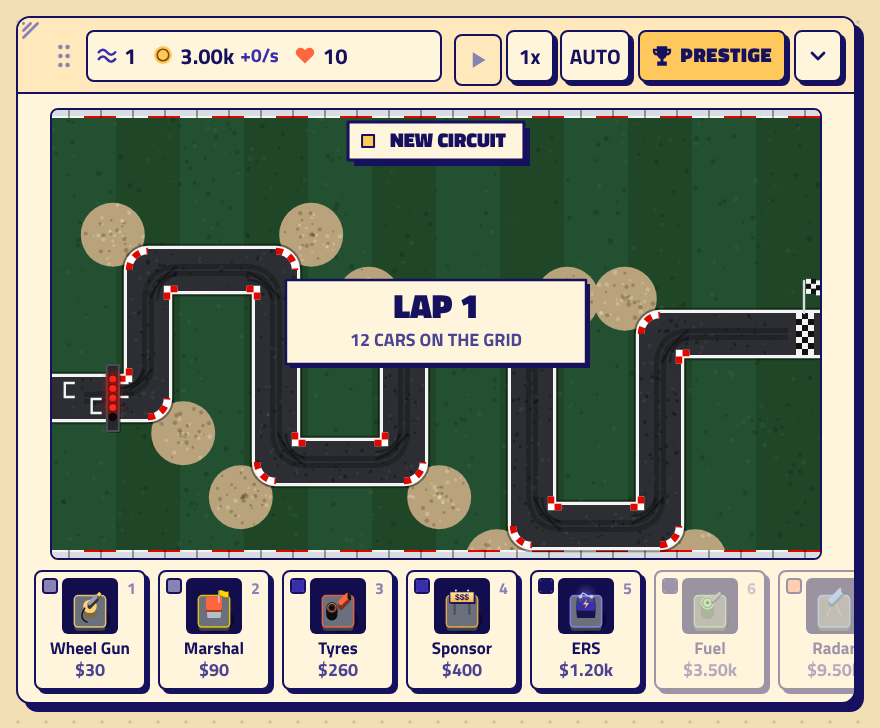

# Neon Siege TD: Tower Defense Mini Game

A small incremental tower defense game set on a Formula 1-style circuit. It floats on top of whatever you're working on, including apps in full screen, and you can drag it anywhere and resize it. It plays silently, with no sound or music.



## Download

Go to [**Releases**](https://github.com/Arnav-Reddy/Neon-Siege-TD/releases/latest) and, under **Assets**, download the file for your system. Don't use the "Source code (zip)" links: those contain the project files, not the app.

| System | File | First launch |
| --- | --- | --- |
| Windows | `Neon-Siege-TD-Setup-x.y.z.exe` (installer) or `Neon-Siege-TD-x.y.z.exe` (portable, no install) | If SmartScreen appears, click **More info → Run anyway**. The app isn't code-signed. |
| macOS | `Neon-Siege-TD-x.y.z-arm64.dmg` for Apple Silicon (M1 and newer), `Neon-Siege-TD-x.y.z.dmg` for Intel | Open the `.dmg` and drag the app to Applications. The first time, right-click it and choose **Open** (or go to **System Settings → Privacy & Security → Open Anyway**). The app isn't notarized. |
| Linux | `Neon-Siege-TD-x.y.z.AppImage` | `chmod +x` the file, then run it. |

## Using the overlay

- The game opens as a borderless widget in the bottom-right corner. There's no taskbar or Dock entry.
- **Move it:** drag the stat bar (or the ⋮⋮ grip) to put it anywhere. It doesn't snap into place: after you drag it, the nearest screen corner becomes its anchor, so minimizing or resizing keeps that corner fixed.
- **Resize it:** drag any edge or corner to scale it from 60% to 250%; the opposite side stays where it is. Double-click an edge to reset to 100%. Size and position are remembered.
- **Show or hide:** press `Ctrl+Shift+T` (`Cmd+Shift+T` on macOS) from any app. Left-click the tray / menu-bar icon to toggle the widget; right-click the icon to open its menu.
- **Quit:** right-click the tray icon and choose **Quit**.
- **Shrink:** the `⌄` button shrinks the widget to a small pill. The window shrinks with it, so it covers nothing else.

It floats over full-screen browsers, videos and apps that use borderless or windowed full screen. On macOS it appears in full-screen Spaces too. Games running in *exclusive* full-screen mode take over the display, so no normal window can draw on top of them. Switch those games to **borderless / windowed full screen** to see the overlay.

## Play in a browser instead

Play it live at **https://arnav-reddy.github.io/Neon-Siege-TD/**, or open `index.html` in any modern browser. The whole game is that one file.

## Updates

The desktop app (v1.0.2 and later) loads the game live from that page. Every update pushed to `main` reaches your installed app the next time you open it, with no new download. From v1.0.5 the desktop app also updates itself: on Windows (installer) and Linux it downloads new releases in the background and installs them when you quit (or choose **Restart to update** in the tray menu). On macOS and with the Windows portable .exe it tells you a new version is out and opens its download page in one click, because macOS only lets apps signed with a paid Apple Developer certificate replace themselves. The app also bundles a local copy of the game and falls back to it when GitHub Pages is unreachable or returns an error. For development, `npm start -- --local` runs the in-repo `index.html` directly.

The game also updates itself. At start-up it compares its version with the `index.html` on GitHub. When a newer version exists, an **Update** box offers **Update & Reload Now** or **Later**. The new version is cached in the browser and loads instantly from then on. You can check by hand with **⟳ Check updates** on the home screen, and change the update URL with **⚙**.

## Controls

| Action | How |
| --- | --- |
| Pick a tower | Click it in the dock, or press `1`–`9`, `0`, `-` |
| Place a tower | Click an empty tile |
| Inspect, upgrade or sell | Click a placed tower |
| Upgrade as far as your gold allows | `MAX` next to Upgrade |
| Overdrive (Lv5+) | `Push Lap` in the inspector |
| Target priority (Lv3+) | First · Strongest · Shielded · Support Vans |
| Reboot a jammed tower | Click it |
| Pit stop (Pit-Crew Gantry) | Click the tower while its PIT light is on |
| Cancel | Right-click or `Esc` |
| Start the next lap | `▶` or `Space` |
| Speed | `1x·2x·3x` |
| Auto-lap | `AUTO` starts the next lap automatically |
| Pin a mutation | `📌 Select` under a mutation picks it now and on every later mutation of that tower; `📌 … ✕` in the inspector unpins |
| Safety Car | `SC`: cars slow by 75% for 6 s, 45 s cooldown |
| Prestige | `🏆 Prestige` |
| Save slots | `☰` returns to the home screen |

## Features

- **Five save slots:** the home screen lists five garage slots. Each has a name, season, lap, best lap, CP and gold. You can rename, export or delete a slot (deleting asks twice) and import a save into the first empty slot. **Continue Last Session** reopens the slot you played last. Old single saves move into Slot 1 as "Legacy Team".
- **Random circuits:** every run gets a new winding 12×7 Grand Prix layout with kerbs, gravel traps, a starting grid under a five-light gantry and a chequered finish. Two or three **hot-zone tiles** sit next to the track: **DRS** (+40% attack speed), **Grandstand** (+50% range, +25% crit chance) and **VIP** (+100% kill payout).
- **20 trackside towers, unlocked by prestige rank:**
  - P0: Wheel Gun $100, Marshal $350, Tyres $1K, Sponsor $1.1K, Wind Tunnel $900, ERS $3.6K
  - P1: Fuel $11K, Radar $32K, Pit Crew $90K, Timing $100K
  - P2: Mortar $240K, Race Control $650K, EMP $1.8M
  - P3: Singularity $5.5M, Solar $18M, Orbital $45M
  - P5: Tachyon $180M, Reactor $650M
  - P8: Spire $2.5B, Dyson $12B

  Locked towers show their rank on the dock.
- **Tower cap:** you can field 5 towers, plus 1 per prestige rank and 1 per Pit Garage Expansion.
- **Levels:** every level costs 1.6× the last and gives about +30% power, plus tower perks (extra barrels, more chain jumps, rail pierce, flak fragments and more). The inspector previews the next level's change. Lv3 unlocks target priority. Lv5 unlocks **Push Lap** (+60% fire rate for 4 s, 20 s cooldown) and the first **mutation draft**. You choose 1 of 3 mutations (4 with HQ), and a mutation can be stacked. Press **📌 Select** under a mutation to pin it: that tower then takes it automatically every time it mutates, until you unpin it in the inspector. `MAX` buys every level you can afford, then shows each earned draft one at a time (or applies the pinned mutation).
- **Economy without car money:** kill and lap gold grow slowly (`13.5 × 1.08^lap`). Four towers make money:
  - **Sponsor Billboard:** earns gold every second of a lap, plus a lap-end bonus worth 25 seconds of income. Mutations: Title Sponsor, Prize Money, Merch Stand (+40% kill gold for towers in its radius).
  - **Trackside Wind Tunnel:** charges from 30 shots by adjacent towers and pays out at most 3 times a lap.
  - **Pit-Crew Gantry:** every 18 s a 3.5 s PIT window opens. Click it for a full payout; a missed window pays 30%. At most 2 pit stops a lap.
  - **Paddock Solar Grid:** pays at the end of each lap for every empty pad, scaled by weather (sun 100%, rain 40%, night 0%).
- **Weather** changes every 5 laps. **Rain** halves fire damage and doubles ERS and EMP damage. **Night** cuts the range of unlit towers by 25% and raises bounties by 50%.
- **Race cars:** HP grows 1.18× per lap.
  - **Tyres:** soft (red) cars burst fast; hard (white) cars resist fire and speed up over time.
  - **Lap 25 and later:** adaptive chassis resist the damage type you used most.
  - **Lap 30 and later:** support vans heal the cars around them.
  - **Lap 40 and later:** stealth cars that long-range towers can't see until EMP, Timing or floodlights light them.
  - **Lap 55 and later:** holograms split into three decoys at half health.
  - **Lap 70 and later:** wet tyres ignore every slow except EMP and Race Control.
- **Multi-phase bosses** on laps 10, 20, 24, 30, 40 and later: Silver Arrow V12, Scuderia Juggernaut (frontal armour), Apex Phantom X (phase-dodge) and the Grand Prix Leviathan. Each phase triggers at a marked point on the boss health bar:
  - At 75%, an EMP jammer stuns your two strongest towers; click them to reboot.
  - At 50%, the boss pits to heal behind a shield.
  - At 25%, four escorts join.
- **Seasons:** a season is 24 laps and ends with a finale boss. You then choose:
  - **Next Season:** cars get +35% HP per season and pay more CP.
  - **Keep Racing:** endless laps, 1 CP every 3 laps.
  - **Prestige:** once you reach the rank's lap target, prestige raises your rank, unlocks towers and adds a tower slot.
- **Constructors' HQ:** spend CP on Pit Garage Expansion, Mutation Rerolls, Starting Gold, Tile Buff Multipliers, 4-Choice Drafts and Power Unit R&D (+20% damage).
- **Big numbers** stay compact: 1.25K, 10.0M, 2.50B, 15.4T, with fixed-width digits.

## Build it yourself

```bash
npm install
```

```bash
npm start
```

```bash
npm run dist
```

`npm start` runs the overlay, and `npm run dist` builds an installer for your OS into `dist/`.

**Publish a release:** go to **Actions → Release → Run workflow**. GitHub builds Windows, macOS and Linux and publishes them as release `v<version>`, using the version in `package.json`. Bump that version before publishing the next release.

## Credits

The UI font is [Titillium Web](https://fonts.google.com/specimen/Titillium+Web) (SIL Open Font License 1.1). It's embedded in `index.html` so the game works offline.
